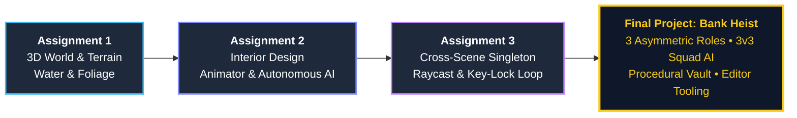

https://github.com/user-attachments/assets/b79e6b8c-a0fd-414b-a8b6-54390bd258a5

<div align="center">

# 🏦 The Great Bank Heist — 3D Tactical Action & Multi-Role Game
### Game Development Portfolio & Capstone Project (Summer 2026)
**Afeka College of Engineering**  
**Developer:** David Ben Yakov

[-black?style=for-the-badge&logo=unity)](https://unity.com/)
[](https://learn.microsoft.com/en-us/dotnet/csharp/)
[](https://docs.unity3d.com/Manual/nav-NavigationSystem.html)
[](#)
[](#)
[](#)

</div>

---

## 🎬 Final Project Gameplay Showcase

> **💡 Interactive Gameplay Recording:** Watch the full multi-role playthrough demonstrating the Robber heist, SWAT breach, Bystander survival, procedural vault architecture, and real-time 3D victory cutscenes.

<!-- DRAG AND DROP YOUR FINAL .MP4 GAMEPLAY VIDEO FILE RIGHT BELOW THIS LINE IN GITHUB'S WEB EDITOR -->
*🎥 https://github.com/user-attachments/assets/2a280b5b-1979-432d-8616-d36ad04c4c0f

---

## 🧭 Project Evolution: From Environment Design to Tactical 3v3 HeistSim

This repository documents the complete engineering progression of the 3D game across four milestones—evolving from static terrain sculpting into a full multi-scene tactical action game with autonomous squad AI, procedural interior generation, ballistic physics, custom Unity Editor tooling, and real-time cinematic direction.



---

## 🏆 Capstone Project: *The Great Bank Heist*
**Status:** Completed ✅

An asymmetric 3D first-person tactical action game spanning **3 interconnected scenes** (`Outdoors`, `Bank`, and `Vault`), where the narrative, AI placement, win/loss conditions, weapon loadouts, and ending cutscenes dynamically adapt to the player's chosen role.

### 🎭 Asymmetric Role-Playing System (3 Playable Perspectives)

| Feature / Mechanic | 🥷 Robber Commander | 🚓 SWAT Police Commander | 🕴️ Bank Bystander (Civilian) |
| :--- | :--- | :--- | :--- |
| **Starting Objective** | Rally squad (`Daniel` & `Max`) at the safehouse, infiltrate the Bank, and aim your weapon at the Clerk to force out the Vault Key. | Respond to a live radio dispatch on the street, track the 3D spatial bank alarm, and breach the Vault to stop the crew. | Enter the Bank, withdraw savings (`[E]`) at the counter, and survive when the armed robbery erupts around you. |
| **Core Loop & Timer** | **60-Second SWAT Countdown:** Empty 100% of the Vault cash before the siren ends to escape early, or fight through the SWAT breach. | **Tactical Breach:** Hostages in the lobby direct your squad downstairs into the Vault where an immediate 3v3 firefight begins. | **Crossfire Survival:** Take cover in the lobby while AI Police and Robbers fight to the death; crossing their line of fire deals heavy damage (`-35 HP`). |
| **Squad & Weapons** | Custom Robber Pistol + Physical 3D Muzzle Flash + 2 Armed AI Teammates. | Custom SWAT Rifle + Physical 3D Muzzle Flash + 2 SWAT AI Officers. | Unarmed civilian perspective (Crosshair & weapons hidden; relies on positioning and cover). |
| **Victory Condition** | Eliminate blocking SWAT forces (or beat the 60s clock) and reach the purple **Getaway Vehicle** outside. | Neutralize the Robber squad inside the Vault, Lobby, or Street. | Survive until one faction eliminates the other, then exit safely through the Bank's front doors. |
| **Real-Time 3D Cutscene** | **1:23.904** — Squad regroups by the purple getaway car and races down an endless highway pursued by police cruisers under falling gold. | **1:47.112** — Robbers are physically handcuffed in a semi-circle of flashing cruisers, escorted into police cars, and driven away in a convoy. | **2:11.544** — High-life highway cruise with police cruisers flashing in the background and continuous gold rain. |

---

### ⚙️ Core Engineering & Technical Architecture

#### 1. 3v3 Tactical Squad AI & Cross-Scene Pursuit (`SquadMemberAI.cs` & `SquadCommander.cs`)
- **Asymmetric 3v3 Spawning:** Dynamically deactivates the AI leader (`Index 0`) of the player's chosen faction so the player assumes command alongside teammates `1` and `2`, while keeping all 3 AI units (`0, 1, 2`) active for the opposing faction.
- **Real-Time Squad Orders (`[1]`–`[4]`):**
  - `[1] Open Fire`: Transitions squad state to `AttackShooting` with target acquisition, line-of-sight rotation, and 2D tactical radio audio confirmation.
  - `[2] Throw Grenades`: Triggers the `ThrowBomb` animation and launches a physics-based ballistic grenade (`GrenadeProjectile`) toward the nearest enemy.
  - `[3] Tactical Retreat`: Orders teammates to fall back toward designated room exit points.
  - `[4] Regroup & Follow`: Returns squad to formation offsets (`GetFormationPosition`) behind the commander with collision avoidance (`Physics.IgnoreCollision` prevents AI from pushing the player through walls).
- **Cross-Scene Persistence & Pursuit:** Once combat begins (`FirefightStarted`), surviving teammates and enemies persist across scene transitions (`Vault` ⇄ `Bank` ⇄ `Outdoors`) with their exact `HP` (`SavedUnitHP`) and alive/dead status (`DeadUnitsRegistry`).
- **Two-Casualty Squad Defeat Rule:** Losing both AI teammates immediately triggers a tactical defeat—enforcing team preservation rather than solo run-and-gun play.

#### 2. Ballistic Grenade Physics & First-Person Weapon System (`GrenadeProjectile.cs` & `PlayerWeaponController.cs`)
- **Ballistic Arc Calculation:** Computes exact launch velocity vectors (`velocityXZ` & `velocityY`) to lob physical `Rigidbody` grenades with bouncy `PhysicsMaterial`, blinking red warning lights, 3D explosion audio, and distance-falloff `OverlapSphere` damage (with friendly-fire immunity for the player's squad).
- **Procedural Recoil & Dynamic Crosshair:** Smooth `Vector3.Lerp` weapon kickback, role-specific 3D weapon models, procedural 3D star muzzle flashes, and a 5-part UI crosshair that expands on fire and turns red when raycasting onto living enemies.

#### 3. Procedural Interior Architecture Generator (`BankAndVaultInteriorBuilder.cs`)
- Built a custom editor/runtime procedural architecture builder (`[ContextMenu("Build Scene Interior Now")]`) that constructs:
  - **Grand Bank Lobby:** Marble floors, coffered wood-beam ceilings, classical pillars, velvet rope queue stanchions, upholstered waiting benches, bulletproof teller glass, and an enclosed **downstairs vault staircase** with an invisible smooth collider ramp (`SmoothStairWalkRamp`) for seamless AI/Player navigation.
  - **Fortified Bank Vault (`Vault` Scene):** Heavy circular steel vault doors with spoke wheels and locking bolts, walls of 144 numbered safety deposit boxes, steel tables stacked with gold bullion, and grid-aligned collectible cash bundles (`CoinBehaviour`).

#### 4. Real-Time 3D Cutscene Director & Endless Highway System (`VictoryCinematicDirector.cs`)
- Instead of static pre-rendered video files, victory sequences are directed in real time using a dedicated `CinematicDirectorCamera`:
  - **Endless Highway Strip:** Dynamically recycles 16 road segments (asphalt, lane markings, guardrails, street lamps, and trees) ahead of moving vehicles so high-speed chases run smoothly for over 2 minutes without colliding with city buildings or terrain mountains.
  - **3-Stage Credits Flow:** Displays the victory headline centered for 7 seconds, scrolls the credits once from bottom to top, and transitions to a final *"Thank You For Playing"* showcase until the role's musical theme finishes.

#### 5. Zero-Dependency Character Voice Synthesizer (`DialogueVoiceSynthesizer.cs` & `StoryAndDialogueManager.cs`)
- Synthesizes real-time spoken English dialogue for every character (`Daniel`, `Max`, `Sgt. Roi`, `Officer Maya`, `Bank Clerk`, and `Police Dispatch`) with distinct vocal profiles and speaking rates, preceded by a procedurally generated dual-frequency tactical radio PTT beep (`AudioClip.Create`).

#### 6. Full Menu System, Live Options & Anti-Exploit Guards (`MenuAndGameManager.cs`)
- **In-Game Options (`OptionsPanel`):** Live Music Mute/Unmute toggle and real-time Difficulty switching (`Easy` / `Normal` / `Hard`) that scales enemy damage and HUD telemetry.
- **Mid-Game Role Lock:** Separates `PendingMenuRole` from the active match's `SelectedRole` so players cannot exploit the pause menu to swap roles mid-heist (`Continue` strictly resumes the original role; role changes apply only on `New Game`).
- **7-Second Defeat Screen Guard:** Delays the appearance of the `Main Menu` button on the defeat screen for 7 seconds so rapid gunfire clicks at the moment of death never accidentally dismiss the screen.

#### 7. Custom Unity Editor Dependency Analyzer & Asset Pruner (`ProjectCleanerTool.cs`)
- Engineered a custom `UnityEditor` pipeline tool (`[MenuItem("Tools/Clean Unused Project Assets")]`) to eliminate unused 3rd-party Asset Store bloat prior to Git deployment:
  - **Recursive Dependency Graph Resolution:** Scans the active scenes (`Outdoors`, `Bank`, `Vault`) via `AssetDatabase.GetDependencies(scenesArray, true)` to build a whitelist of all actively referenced models, prefabs, materials, textures, animations, and audio clips.
  - **Safe Batch Pruning:** Wraps deletions inside `AssetDatabase.StartAssetEditing()` / `StopAssetEditing()` blocks for fast execution while safeguarding all `.cs` scripts, shaders, URP settings, and `TextMesh Pro` resources, followed by a recursive bottom-up pass that purges empty directories and `.meta` orphans.

---

## 🎮 Controls & Keybindings

| Key / Input | Action | Context |
| :---: | :--- | :--- |
| `W` `A` `S` `D` + `Mouse` | Move & Look Around (`Left Shift` to Sprint) | All Roles |
| `Left Mouse Click` | Fire Weapon (with Recoil & Muzzle Flash) | Robber / Police |
| `G` | Throw Physical Fragmentation Grenade | Robber / Police |
| `1` / `2` / `3` / `4` | Squad Commands: **Fire** / **Grenade** / **Retreat** / **Follow** | Robber / Police |
| `E` / `Space` | Interact: Pick up Vault Key, Withdraw Cash, Open Doors / Portals | All Roles |
| `T` | Interactive Context-Aware Dialogue with Squad Teammates | All Roles |
| `ESC` | Open In-Game Pause Overlay / Return from Options | All Scenes |

---

## 📂 Earlier Course Milestones (Assignments 1–3)

<details>
<summary><b>🌲 Assignment 1: Legendary Village Environment (Click to Expand)</b></summary>
<br/>

**Status:** Completed ✅

Designed and built the foundational 3D environment for a legendary village situated on both banks of a river.
- **Goal:** Design a rich, atmospheric 3D environment using Unity's Terrain system and Asset packages.
- **Features Included:**
  - Sculpted terrain with a central river and water shaders.
  - A village layout distributed across two river banks connected by a bridge.
  - Placed environmental assets: houses, a pub, merchant stalls, and dirt paths.
  - Painted foliage (trees, bushes, and grass) for a mythical atmosphere.
  - Fixed scaling and proportions for imported 3D models.
</details>

<details>
<summary><b>🍺 Assignment 2: The Pub Interior & Character Animations (Click to Expand)</b></summary>
<br/>

**Status:** Completed ✅

Expanded one of the village buildings into a fully furnished, multi-story pub with animated NPCs and spatial audio.
- **Requirements & Extra Features Implemented:**
  - Furnished multi-story interior with tables, chairs, fireplace, lighting, background music, and character voice audio.
  - **Advanced AI:** Autonomous animal NPCs featuring Raycast obstacle avoidance, curved wandering paths, and a proximity-based fleeing system.
  - **Interactive Portals:** Custom scene transitions requiring explicit player input (`E`), synced with animation/sound delays, and integrated with `PersistentObjectManager`.
  - **Collision Optimization:** Smooth stair climbing mechanics utilizing invisible ramp colliders.
  - **Smart Interaction:** Custom C# scripts for interactive doors and drawers with proximity detection and automated state resets.
</details>

<details>
<summary><b>🗝️ Assignment 3: Multi-Scene Persistence, Chest & Key Mechanics (Click to Expand)</b></summary>
<br/>

**Status:** Completed ✅

Implemented cross-scene state management, physics-based line-of-sight interactions, and a key-and-lock progression loop across multiple interiors.
- **Features Included:**
  - **Cross-Scene State Persistence:** Seamless preservation of collected Gold Coins (`PersistentObjectManager`), weapon states (`HasGun`), and key ownership (`KeyPickup.HasKey` & `KeyWasCollectedOnce`).
  - **Smart Player Repositioning:** Automatic saving of entry door coordinates and rotation, spawning the player right outside the exited building facing forward upon return.
  - **Dual-Condition Chest Interaction (`ChestBehavior`):** Requires both physical proximity (`OnTriggerEnter`) and direct line-of-sight (`Physics.Raycast`) to open the lid (`SPACE`), play audio, and switch layers (`Ignore Raycast`) to reveal the key.
  - **Key & Locked Door System (`KeyPickup` & `LockedDoorBehavior`):** Collectible key that unlocks locked doors with context-sensitive UI prompts.
</details>

---

## 🚀 How to Open & Run the Project

1. Clone this repository:
   ```bash
   git clone <YOUR_REPOSITORY_URL>
   ```
2. Open **Unity Hub** and add the cloned project folder (**Unity 6 / 6000.x** with Universal Render Pipeline).
3. Ensure the 3 core scenes are added in **File ➔ Build Profiles (Scene List)** in this order:
   - `0`: `Assets/Scenes/Outdoors.unity`
   - `1`: `Assets/Scenes/Bank.unity`
   - `2`: `Assets/Scenes/Vault.unity`
4. Open `Assets/Scenes/Outdoors.unity` and press **Play**!
   - *Tip:* Enter secret codes `HEIST` or `VIP` in the main menu input field for a starting bonus (`+50 Gold` & `+50 HP`), or `KEY` to start with the Master Vault Key.

---
<div align="center">
  <i>Architected & Developed by <b>David Benyakov</b> • Configured with custom Editor dependency pruning and a strict Unity <code>.gitignore</code>.</i>
</div>
